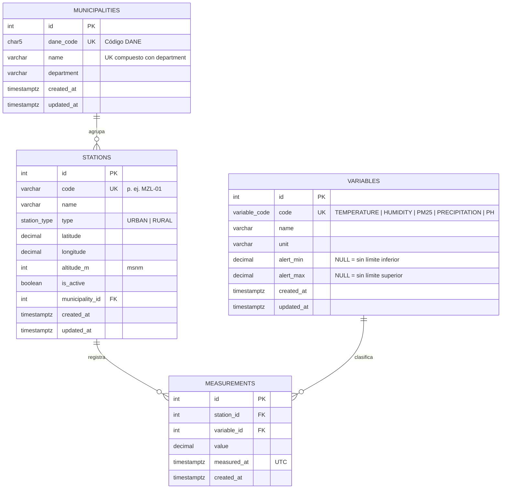

# Modelo de base de datos

Base de datos PostgreSQL gestionada con Prisma. La fuente de verdad del esquema es
[`prisma/schema.prisma`](../prisma/schema.prisma) y los cambios se aplican mediante las
migraciones versionadas en [`prisma/migrations`](../prisma/migrations).

## Diagrama entidad-relación

## Decisiones de diseño

| Decisión | Motivo |
|---|---|
| **Mediciones en formato largo** (una fila por estación + variable + instante) | Filtrar por variable, agregar y evaluar umbrales funciona igual para todas las variables. Agregar un nuevo indicador es insertar una fila en `variables`, sin cambiar el esquema. |
| **Umbrales en la tabla `variables`** | Los umbrales son datos, no código. Se pueden ajustar sin desplegar de nuevo y la lógica de alertas es genérica: alerta si `value > alert_max` o `value < alert_min`. |
| **Catálogo de variables en una migración** | Son datos de referencia del dominio (no sintéticos): cualquier base migrada los tiene, se carguen o no los datos de prueba. |
| **Alertas calculadas al consultar** | Se evita duplicar información y el riesgo de inconsistencias si cambia un umbral. |
| **`DECIMAL(8,2)` para valores y umbrales** | Representación exacta: un valor de `35.00` nunca se interpreta como `35.0000001` al compararlo con el umbral. |
| **`TIMESTAMPTZ` en UTC** | Las fechas se almacenan sin ambigüedad de zona horaria; la API acepta fechas ISO 8601 con desplazamiento (p. ej. `-05:00` para Colombia). |
| **`ON DELETE RESTRICT`** en todas las llaves foráneas | No se puede borrar una estación, variable o municipio con historial asociado: el histórico de monitoreo no se pierde por accidente. |
| **Código DANE en municipios** | Identificador oficial y estable de los municipios colombianos. |

## Integridad de los datos

Además de llaves primarias, foráneas y únicas, la migración inicial agrega restricciones
`CHECK` que Prisma no expresa en el schema:

| Restricción | Regla |
|---|---|
| `municipalities_dane_code_format_chk` | El código DANE son exactamente 5 dígitos. |
| `stations_latitude_range_chk` / `stations_longitude_range_chk` | Coordenadas geográficas válidas. |
| `stations_altitude_range_chk` | Altitud entre -500 y 9000 m. |
| `variables_alert_range_chk` | Si hay ambos umbrales, `alert_min < alert_max`. |
| `measurements_station_id_variable_id_measured_at_key` (único) | Una estación no puede registrar dos valores de la misma variable en el mismo instante. |

## Índices

| Índice | Consulta que optimiza |
|---|---|
| `(station_id, variable_id, measured_at)` (único) | Filtro por estación, variable y rango de fechas (caso más común en los análisis). |
| `(variable_id, measured_at)` | Filtro por variable y rango de fechas en todas las estaciones. |
| `(measured_at)` | Filtro solo por rango de fechas. |
| `(municipality_id)` en `stations` | Estaciones por municipio. |

## Umbrales de alerta (definidos en la prueba técnica)

| Variable | Código | Unidad | Condición de alerta |
|---|---|---|---|
| Temperatura ambiental | `TEMPERATURE` | °C | Mayor a 35 |
| Humedad relativa | `HUMIDITY` | % | Mayor a 95 |
| Material particulado PM2.5 | `PM25` | µg/m³ | Mayor a 25 |
| Precipitación | `PRECIPITATION` | mm | Mayor a 50 |
| Calidad del agua (pH) | `PH` | pH | Menor a 6 o mayor a 9 |
